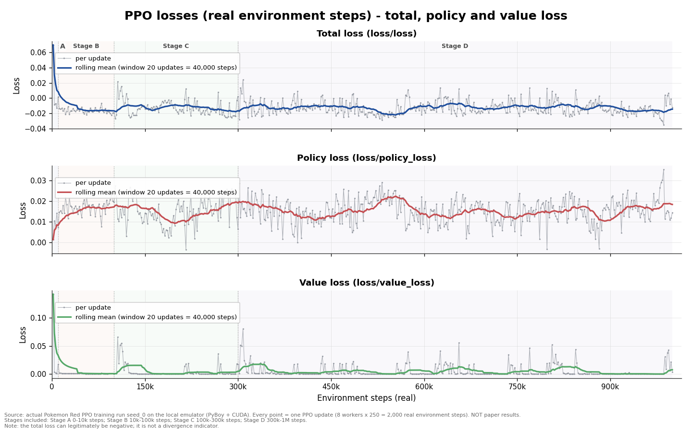
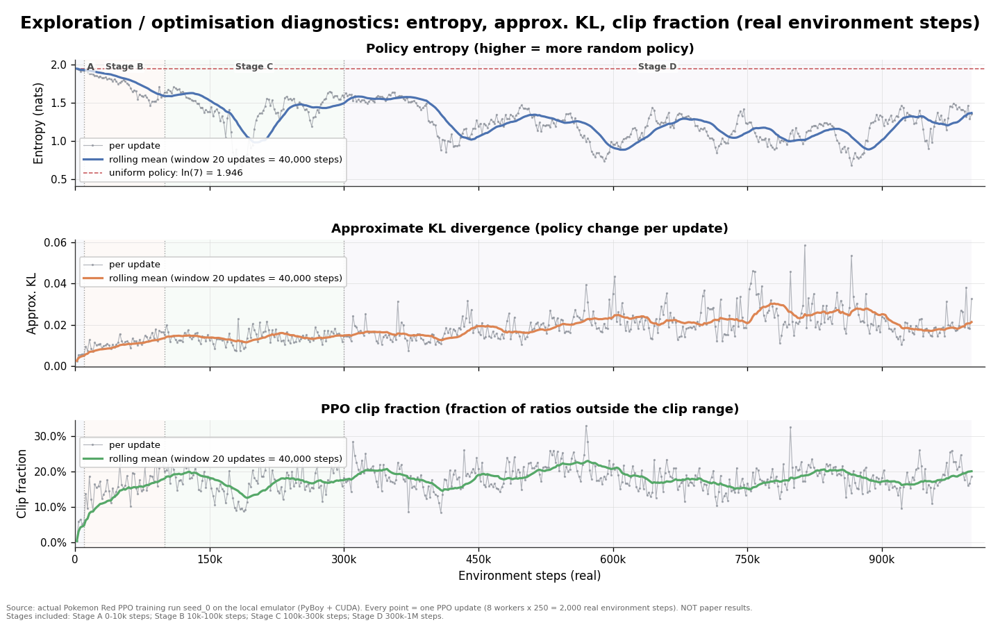
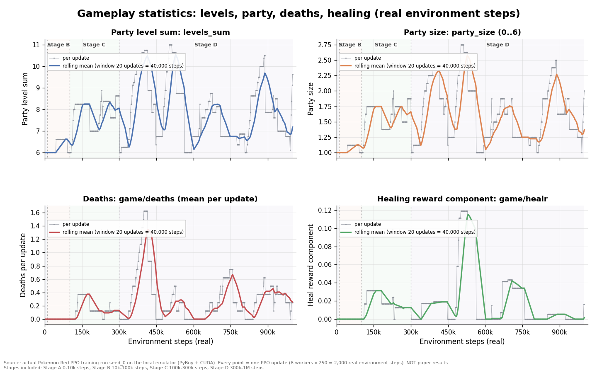
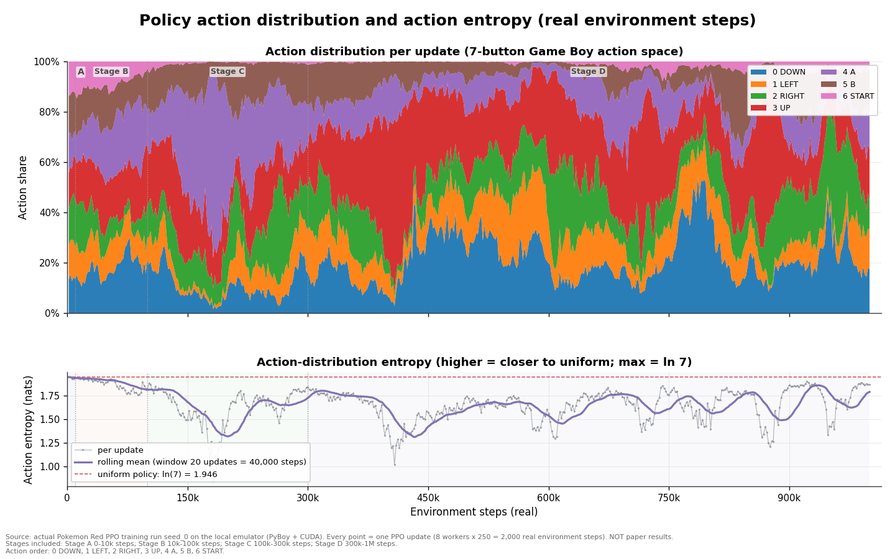
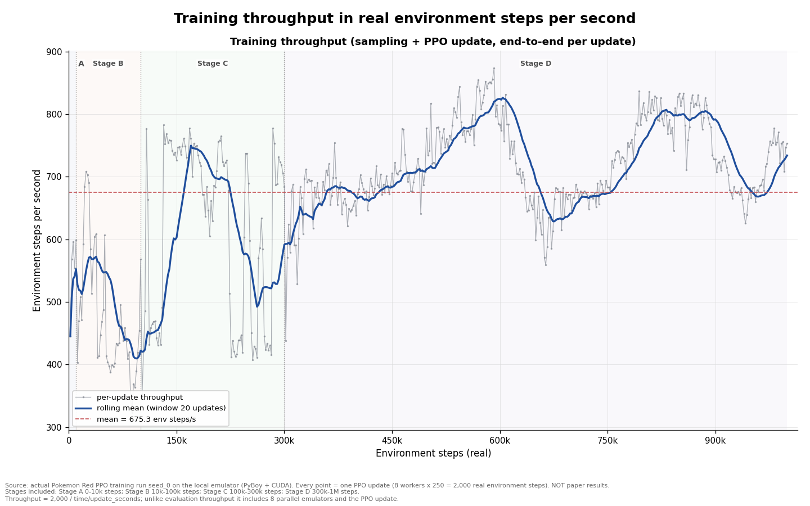

# 训练曲线分析：Pokémon Red PPO（seed_0，真实环境步）

> **数据状态**：已纳入全部阶段（累计 1,000,000 环境步），本版为完整版。
> 生成时间：2026-10-18T00:53:04+08:00；脚本：`scripts/plot_training_curves.py`；数据：`C:\Users\lihao\Desktop\pokemon-red-rl-reproduction\artifacts\training\seed_0`；Git：`ed4fcb2f55043bd5ed80c26e6984ebfd264abaca`。

本报告由 `scripts/plot_training_curves.py` 从真实训练日志自动生成，只做只读分析（不训练、不评估、不用 GPU）。所有曲线都是**本地真实训练**的遥测数据，**不是论文结果**，也不构成性能声明（各阶段 result.json 的 `performance_claim` 均为 `none`）。

## 1. 数据来源与口径

- 实验：`artifacts/training/seed_0/`，配置 `configs/train_seed0.yaml`（论文 PPO 超参不变；本地并行规模 8 workers × 250 steps = **2,000 环境步/update**）。
- 输入文件（只读）：每个阶段的 `metrics.jsonl`（每个 PPO update 一行）与 `episodes.jsonl`（每个被截断的 episode 一行）。阶段按 `progress/environment_steps` 合并并去重，阶段边界不重复计数。
- x 轴统一为 **real environment steps（真实环境步）**；每个点 = 一个 PPO update（2,000 步）；滑动平均窗口 20 updates = 40,000 环境步（窗口首尾用 `min_periods=1`，边缘为不完整窗口）。
- 奖励口径：配置中奖励为塑形组合（`reward_scale=0.5`、`event_weight=4.0`、`level_weight=1.0`、`heal_weight=5.0`、`explore_weight=0.1`）。`rollout/reward_mean` 是每个 update 的 2,000 步内、8 个并行环境平均后的**每环境步**奖励，**不是 episode return，也不是评估分数**；`episodes.jsonl` 的 `reward` 字段是 episode 累计奖励。
- 计算时间口径：`time/update_seconds` 是每个 update 的采样 + PPO 更新时间；“阶段计算时间”为这些值求和，**不含**阶段启动、checkpoint、评估与分析开销；另给出基于 `time/unix` 的墙钟跨度（含阶段间间隙），二者不同。
- `game/*` update 指标口径：训练脚本对 8 个 worker 在 update 内最新一步返回的 info 取算术平均，每个数值是**该 worker 当前 episode 的累计进度**；episode 截断/重置后会回落，因此曲线呈锯齿。它与 `episodes.jsonl` 中**完整 episode 的最大值**不是同一口径；本报告在 §3.2 给 update 级统计、在 §3.3 单独给 episode 级极值，二者不可混读。

## 2. 图表说明

图表目录：`docs/reports/figures/`（1440×900 PNG，dpi 120，英文标签）。每张图的 x 轴均为真实环境步，底部注明数据来自真实训练、非论文结果。

### 图 1：奖励曲线（`figures/fig_reward.png`）


上半部分：`rollout/reward_mean`（每 update 每环境步平均奖励）原始点（灰色）与 20-update 滑动平均线（蓝色）。下半部分：每个已完成 episode 的累计奖励散点，颜色区分阶段；虚线为 episode 均值，细红线为 5 个 episode 的滑动平均。episode 按记录它的 update 窗口定位（在 2,000 步窗口内均匀展开，误差 ≤ 1 个 update）。

读数：`rollout/reward_mean` 首值 0.00037、末值 0.00072，前 10% updates 均值 0.00012、后 10% updates 均值 0.00037；共 66 个完成 episode，episode reward 均值 4.723（范围 0.0800–12.827）。

### 图 2：损失曲线（`figures/fig_loss.png`）



三行分别为总损失 `loss/loss`、策略损失 `loss/policy_loss`、价值损失 `loss/value_loss`，均为原始点 + 滑动平均。

读数：总损失范围 [-0.0352, 0.0698]，末值 -0.0127；策略损失末值 0.0143；价值损失末值 0.00321。PPO 的总损失/策略损失正负号依赖优势估计，**负值本身不代表发散**；训练脚本另有 finite 检查与“参数必须变化”断言。

### 图 3：探索与优化诊断（`figures/fig_entropy_kl.png`）



三行：策略熵（nats，红色虚线为均匀策略上限 ln(7)≈1.946）、近似 KL、PPO clip fraction。

读数：熵 1.944 → 1.351（均值 1.295）；近似 KL 均值 0.0184（最大 0.0586）；clip fraction 均值 0.1782（最大 0.3300）。

### 图 4：探索与剧情进度（`figures/fig_exploration.png`）


2×2：`game/coord_count`（走过的唯一坐标数）、`game/max_map_progress`（官方 essential-map 进度）、`game/num_badges`（徽章数）、`game/event_reward`。注意这些是 update 级 8-worker 最新 info 平均（episode 截断重置时会回落）；完整 episode 的极值见 §3.3。

读数：`coord_count` 末值 215.000（最大 276.375）；`max_map_progress` 最大 1.875；徽章最大 0.00000。

### 图 5：游戏内统计（`figures/fig_gameplay.png`）



2×2：队伍等级和、队伍人数、死亡数、治疗奖励分量（`game/healr`）。同样是 update 级 8-worker 最新 info 平均，episode 重置时会回落。

读数：`levels_sum` 末值 9.625（最大 11.000）；`party_size` 末值 2.000；`deaths` 末值 0.2500（最大 1.625）。

### 图 6：动作分布与动作熵（`figures/fig_actions.png`）



上半部分为 7 个按键动作占比的堆叠面积图（动作顺序 0 DOWN、1 LEFT、2 RIGHT、3 UP、4 A、5 B、6 START），下半部分为动作分布熵（上限 ln(7)≈1.946）。

读数：末值占比 0 DOWN 0.1755, 1 LEFT 0.1590, 2 RIGHT 0.1130, 3 UP 0.2050, 4 A 0.1555, 5 B 0.1585, 6 START 0.0335；动作熵 1.944 → 1.864（均值 1.662）；末次最高占比动作 UP（0.2050）。若某一动作长期占比过高，需要结合评估检查是否存在单一动作刷屏。

### 图 7：训练吞吐（`figures/fig_throughput.png`）



每个 update 的端到端吞吐（2,000 步 / `time/update_seconds`，含 8 个并行模拟器采样与 PPO 更新）原始点、滑动平均与总均值线。

读数：平均 675.308 环境步/秒；范围 322.885–873.897；总计算时间 1,540.0 秒，墙钟跨度 1,619.7 秒（含阶段间隙）。

## 3. 关键数字

### 3.1 阶段汇总

| 阶段 | 环境步区间 | Updates | 计算时间 (s) | 平均吞吐 (steps/s) | 完成 episodes | 状态 |
|---|---|---|---|---|---|---|
| stage_a_10k | 0–10,000 | 5 | 18.316 | 552.542 | 0 | 完成 |
| stage_b_100k | 10,000–100,000 | 45 | 196.615 | 475.559 | 8 | 完成 |
| stage_c_300k | 100,000–300,000 | 100 | 343.175 | 617.559 | 10 | 完成 |
| stage_d_1m | 300,000–1,000,000 | 350 | 981.875 | 719.243 | 48 | 完成 |

### 3.2 指标统计（按 PPO update）

| 指标 | 首值 | 末值 | 均值 | 最小 | 最大 | 最大出现步数 |
|---|---|---|---|---|---|---|
| reward_mean | 0.00037 | 0.00072 | 0.00038 | 0.00000 | 0.00544 | 308,000 |
| loss | 0.0698 | -0.0127 | -0.0129 | -0.0352 | 0.0698 | 2,000 |
| policy_loss | 0.00137 | 0.0143 | 0.0153 | -0.00339 | 0.0353 | 986,000 |
| value_loss | 0.1424 | 0.00321 | 0.00492 | 0.00002 | 0.1424 | 2,000 |
| entropy | 1.944 | 1.351 | 1.295 | 0.5556 | 1.944 | 2,000 |
| approx_kl | 0.00246 | 0.0326 | 0.0184 | 0.00246 | 0.0586 | 814,000 |
| clip_fraction | 0.00333 | 0.1872 | 0.1782 | 0.00333 | 0.3300 | 570,000 |
| coord_count | 18.500 | 215.000 | 165.033 | 2.125 | 276.375 | 414,000 |
| max_map_progress | 0.00000 | 1.625 | 1.141 | 0.00000 | 1.875 | 482,000 |
| num_badges | 0.00000 | 0.00000 | 0.00000 | 0.00000 | 0.00000 | 2,000 |
| event_reward | 0.00000 | 2.000 | 2.607 | 0.00000 | 5.250 | 396,000 |
| levels_sum | 6.000 | 9.625 | 7.737 | 6.000 | 11.000 | 502,000 |
| party_size | 1.000 | 2.000 | 1.577 | 1.000 | 2.750 | 502,000 |
| deaths | 0.00000 | 0.2500 | 0.2507 | 0.00000 | 1.625 | 400,000 |
| healr | 0.00000 | 0.0166 | 0.0177 | 0.00000 | 0.1190 | 502,000 |
| steps_per_second | 445.107 | 753.427 | 675.308 | 322.885 | 873.897 | 592,000 |

注：首/末值为纳入阶段中第一个/最后一个 update 的值；均值为所有 update 的算术平均；“最大出现步数”为该指标最大值的环境步位置。其中 `game/*` 是 8 个 worker 最新 info 的 update 内平均（非 episode 最大值，episode 截断时会回落；完整 episode 极值见 §3.3）。

### 3.3 Episode 统计

| 指标 | 数值 | 说明 |
|---|---|---|
| 完成 episode 数 | 66 | 每个 episode 在 10,240 步（出现新事件可至 16,384 步）被截断，样本很少 |
| episode reward 均值 / 标准差 | 4.723 / 3.671 | episodes.jsonl 的累计奖励 |
| episode reward 最小 / 中位 / 最大 | 0.0800 / 4.168 / 12.827 | 方差大，不能作为稳定评估 |
| episode 长度均值 / 最小 / 最大（步） | 13,249.9 / 10,240 / 18,432 | 长于 10,240 表示事件延长了 episode |
| episode 定位方式 | episodes placed inside the update window in which they were logged (uniformly spread over 2,000 steps; error <= 1 update) | 用于 fig_reward 散点的 x 轴 |

| 阶段 | episode 数 | reward 均值 | reward 最大 | coord 最大 | max_map_progress 最大 | levels_sum 最大 | party_size 最大 |
|---|---|---|---|---|---|---|---|
| stage_a_10k | 0 | n/a | n/a | n/a | n/a | n/a | n/a |
| stage_b_100k | 8 | 0.7388 | 2.550 | 246.000 | 2.000 | 11.000 | 2.000 |
| stage_c_300k | 10 | 5.005 | 8.272 | 337.000 | 2.000 | 14.000 | 3.000 |
| stage_d_1m | 48 | 5.328 | 12.827 | 430.000 | 3.000 | 20.000 | 6.000 |

**episode 级极值**（`episodes.jsonl`，只统计被截断的完整 episode；与 §3.2 的 update 级 8-worker 平均不同）：

| 指标 | 全部 episode 最大值 | 说明 |
|---|---|---|
| coord_count | 430.000 | 单 episode 走过的唯一坐标数 |
| max_map_progress | 3.000 | 官方 essential-map 进度（0–14） |
| levels_sum | 20.000 | 队伍等级和 |
| party_size | 6.000 | 队伍人数（0–6） |
| deaths | 4.000 | 全灭次数 |
| num_badges | 0.00000 | 前两个徽章之和（0–2） |
| event_reward | 8.000 | 事件奖励分量累计 |
| mt_moon / cerulean 是否到达 | False / False | episode 记录中是否出现过该地图 |

### 3.4 动作分布（纳入阶段最后一个 update）

| 动作 | 末值占比 | 历史均值占比 | 历史最大占比 | 最大出现步数 |
|---|---|---|---|---|
| 0 DOWN | 0.1755 | 0.1906 | 0.5425 | 786,000 |
| 1 LEFT | 0.1590 | 0.1204 | 0.3450 | 568,000 |
| 2 RIGHT | 0.1130 | 0.1550 | 0.4540 | 954,000 |
| 3 UP | 0.2050 | 0.2520 | 0.6880 | 408,000 |
| 4 A | 0.1555 | 0.1559 | 0.7565 | 182,000 |
| 5 B | 0.1585 | 0.1043 | 0.3000 | 842,000 |
| 6 START | 0.0335 | 0.0217 | 0.1465 | 12,000 |

### 3.5 汇总

- 累计环境步：**1,000,000**；PPO updates：**500**；完成 episode：**66**。
- 计算时间合计 **1,540.0 s**（仅 update 内时间），平均吞吐 **675.308 steps/s**，聚合吞吐 **649.359 steps/s**。
- 游戏进度：徽章最大 0.00000、`max_map_progress` 最大 1.875、`levels_sum` 最大 11.000、`party_size` 最大 2.750；`mt_moon` 到达 = False，`cerulean` 到达 = False。
- episode 级（完整 episode 的最大值）：episode reward 均值 4.723、最大 12.827；coord_count 最大 430.000；max_map_progress 最大 3.000（0–14）；levels_sum 最大 20.000；party_size 最大 6.000；num_badges 最大 0.00000；mt_moon/cerulean 到达 = False/False。

## 4. 诚实限制（请勿过度解读）

1. **训练曲线 ≠ 学会游戏。** 这些曲线只是单个 seed 的训练遥测；上述徽章/剧情指标没有突破时，不能把奖励上升解释为“学会了玩 Pokémon”。
2. **`rollout/reward_mean` 是每环境步的 shaping reward 均值**（每 update 2,000 步、8 环境平均），不是 episode return，也不是评估分数。奖励由事件/等级/治疗/探索等分量加权组成，奖励上升可能来自塑形饱和（例如探索奖励随覆盖饱和），不必然代表策略变强。
3. **episode 样本极少**（阶段 A 不足一个 episode 长度，因此没有 episode 记录），episode reward 方差大；episode 散点按“记录它的 update 窗口内均匀展开”定位，x 轴误差可达 1 个 update = 2,000 环境步。
4. **全部数据来自真实本地训练**（PyBoy + CUDA），不是论文复现结果；本地并行规模（8×250=2,000 步/update）和训练步数都与论文不同，**不能与论文曲线直接对比**。
5. **单 seed、单配置、无重复实验、无置信区间**；曲线末段的统计波动不应被解读为稳定趋势。
6. **训练指标与独立评估口径不同，不可直接比较。** 独立评估（固定协议、checkpoint 推理）由 eval-engineer 用 `scripts/eval_checkpoint.py` 单独完成，协议与限制见 [eval_protocol.md](eval_protocol.md)。
7. **计算时间只统计 update 内耗时**（采样 + PPO 更新），不含阶段启动、checkpoint、评估和分析开销；墙钟跨度另列且含阶段间隙。
8. 滑动平均窗口 20 updates（40,000 环境步）属于事后可视化选择，不改变原始指标；阶段 A 只有 5 个 update，其统计意义有限。
9. 各阶段 `result.json` 的 `performance_claim` 均为 `none`；本报告不做性能声明。
10. **update 级 `game/*` 不是 episode 最大值。** 它们是 8 个 worker 最新 info 的 update 内平均（每个 worker 的当前 episode 累计进度），episode 截断时会回落成锯齿；完整 episode 的极值见 §3.3，两者不可混读。
11. **截至 1,000,000 步**：episode reward 均值 4.723（最大 12.827），episode 级最深 max_map_progress = 3.000（0–14），coord_count 最大 430.000，但徽章仍为 0、未到月见山/华蓝市。奖励与探索指标在上升，**仍不能据此声称模型学会了玩 Pokémon**。

## 5. 复现与更新

```powershell
# 默认：自动纳入所有已完成阶段（Stage D 完成后自动纳入，得到完整 1M 版本）
.venv\Scripts\python.exe scripts\plot_training_curves.py

# 预览：把仍在运行阶段的当前数据也画进来（非最终版）
.venv\Scripts\python.exe scripts\plot_training_curves.py --include-running
```

脚本只读 `stage_*/metrics.jsonl` 与 `stage_*/episodes.jsonl`，输出：7 张 PNG（`docs/reports/figures/`）、`analysis/training_summary.json` + `.md`、`analysis/metrics_10k.csv`、本文件；每次运行会向 `analysis/run_log.json` 追加一条运行记录（时间戳、纳入阶段、步数范围、图文件、错误）。

## 6. 相关文档

- [独立评估协议 v1（eval_protocol.md）](eval_protocol.md)：checkpoint 评估协议、指标口径与已知限制。
- [训练监督 Phase 1（training_supervisor.md）](training_supervisor.md)：环境审查、并行规模基准与阶段计划。
