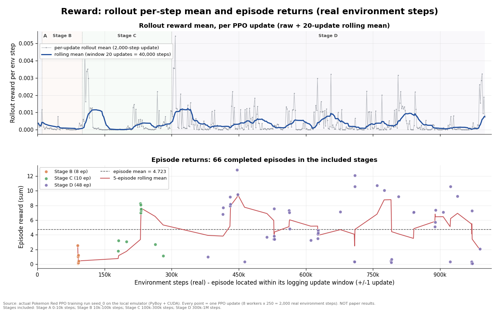
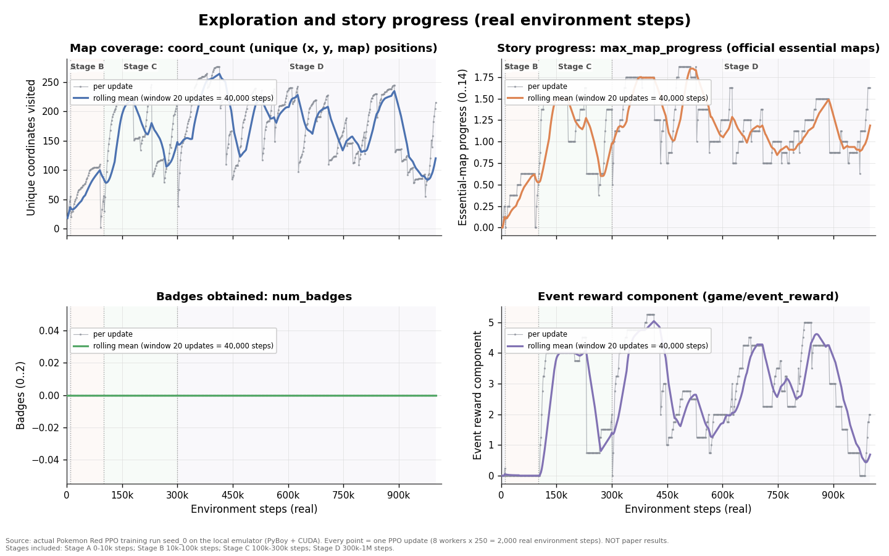
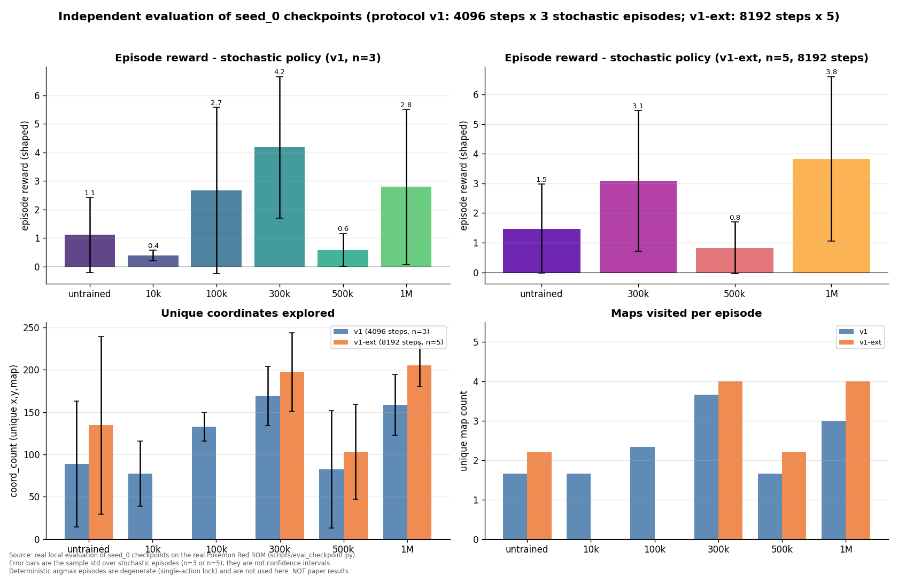

# Pokémon Red PPO 训练监督最终报告（实验 seed_0，累计 1,000,000 真实环境步）

- 报告时间：2026-10-18 01:35（Asia/Shanghai）
- 执行者：RL Training Supervisor（DeepSeek Harness 会话 `session-4a11562b-0d49-4233-9450-d4a8b95de0c9`）
- 项目：`C:\Users\lihao\Desktop\pokemon-red-rl-reproduction`
- 训练预算：累计 1,000,000 真实环境交互步 或 12 小时（先到者为准）→ **以 1,000,000 训练步到达结束，未触及 12 小时上限**
- 状态：**训练、Checkpoint 管理、独立评估、监督与交接文档全部完成；未编造任何实验结果**

## 0. 执行摘要（先读这一段）

1. **训练已按预算完整完成**：从随机初始化开始，累计 **1,000,000** 个真实 Game Boy 环境步（500 次 PPO update，分 A/B/C/D 四个阶段），全部为真实 ROM + 官方初始存档 + 真实 PyBoy 模拟器 + CUDA PPO，不是合成数据。
2. **训练过程稳定**：纯计算 1,540 s（约 25.7 分钟），加上阶段启动/切换共约 27 分钟墙钟；平均 649–675 env steps/s；全程 0 个 NaN/Inf、0 次进程异常退出（除 Stage A 首次启动的一次驱动级崩溃，重试成功）、139 次监督快照 **0 条告警**。
3. **学习信号真实但有限**：训练 66 个完整 episode 的奖励从 B 阶段均值 0.74 提升到 D 阶段均值 5.33（shaped reward），探索坐标从约 20 增至 200+（episode 级最大 430），队伍最多 6 只、等级和最大 20、死亡/捕捉/升级事件均出现；**但没有获得任何道馆徽章，也未到达 Mt Moon 或 Cerulean**，一个 episode 最高只推进到 Viridian City 一带（essential map progress = 3/14）。
4. **独立评估（固定协议）**：训练后的策略能稳定离开 Oak's Lab 探索 Pallet Town（v1-ext 中 1M 模型 5/5 episode 在 121–4,279 步内进入 Pallet Town，且 4.0 个不同地图；未训练基线 5 个 episode 中 3 个 8,192 步都没离开出生房间），探索广度优于未训练/随机基线；但 n=5 小样本，不能做显著性宣称。**1M checkpoint 在扩展评估中综合最佳，300k 为次优**。
5. **重要诚实发现**：所有 checkpoint 的 **确定性 argmax 推理都退化为单个按键粘滞**（停在出生房间，coords=1），确定性轨迹没有区分度；探索行为只在随机采样推理下出现。这与“策略仍接近多峰/熵较高、argmax 在初始状态塌缩”一致，已单列报告。
6. **建议**：可以扩大训练规模。当前 1M 步仅为论文完整配置（32 workers × 2048 steps × 50,000 updates ≈ 3.2×10⁹ 步）的 **约 0.03%**；本机吞吐约 650 steps/s，建议下一轮先以 10M–50M 步为增量继续从 1M checkpoint 训练，并保持阶段评估、Checkpoint 原子保存与异常监督机制。**本轮未擅自扩大预算。**

## 1. 实验身份与可复现信息

| 项目 | 值 |
|---|---|
| 实验 | `artifacts/training/seed_0/`（独立实验，与 Phase1 smoke 产物严格分开） |
| 配置 | `configs/train_seed0.yaml`（论文 PPO 超参不变；仅并行规模与 checkpoint 间隔按本机调整） |
| 随机种子 | `seed = 0`（固定） |
| 代码版本 | neroRL `poke_red` SHA `1d5c2db1f47f29d501ec9eacdc9c7f6480ea6217`；本地 Git 提交 `ed4fcb2`（训练期间工作树干净） |
| ROM | `local/PokemonRed.gb`，SHA1 `ea9bcae617fdf159b045185467ae58b2e4a48b9a`（英文原版，未复制/未上传） |
| 初始状态 | `local/has_pokedex_nballs.state`，SHA256 `0ff708b3dcdfa6c1f5fc07687b1641247017b1eb8a9a8b7c6eb0dd988431bd7e` |
| 软件 | Python 3.10.11、PyTorch 2.5.1+cu121、PyBoy 2.4.0、Gymnasium 0.29.0、TensorBoard 2.18.0 |
| 硬件 | i9-13900HX（24C/32T）、16 GB RAM、RTX 4060 Laptop 8 GB（驱动 592.82） |
| 各 run provenance | 每个阶段目录的 `environment.json` 记录 Git SHA、ROM/状态哈希、seed、device、resume 来源、目标步数 |

每个阶段的配置快照、环境信息、指标与 checkpoint 均保存在该阶段目录：`stage_a_10k/`、`stage_b_100k/`、`stage_c_300k/`、`stage_d_1m/`。

## 2. 训练方法与并行规模选择（不套用论文 32 worker）

- 论文完整配置为 **32 workers × 2048 steps = 65,536 步/update**（仅 screen rollout 就 ~4.22 GiB），本机 16 GB RAM + 已有桌面应用不可行。
- 按任务要求先做真实基准再调整（`artifacts/training/bench/`，只改 worker 数、不动 PPO 超参）：

| 变体 | batch | update 耗时 | 端到端吞吐 | python RSS 峰值 | 结论 |
|---|---:|---:|---:|---:|---|
| 8 × 250 | 2,000 | 3.90 s | 513.1 steps/s | 5.68 GB | **采用**（吞吐足够、内存余量最大） |
| 12 × 170 | 2,040 | 3.90 s | 523.6 steps/s | 7.71 GB | +2% 吞吐、+2 GB 内存，不划算 |
| 16 × 125 | 2,000 | 3.66 s | 546.2 steps/s | 9.27 GB | +6% 吞吐、+3.6 GB 内存，风险高 |
| 20 × 100 | 2,000 | 未完成 | — | >10 GB | 内存过载、驱动短暂失联，**放弃** |

- 正式配置：**8 workers × 250 steps = 2,000 步/update**，batch=2000 整除所有阶段目标（10k/100k/300k/1M），里程碑都落在精确 update 边界，没有多训步数。
- PPO/奖励/网络/观测/动作全部等于论文 baseline：gamma 0.997、lambda 0.95、clip 0.2、value coef 0.5、max grad norm 0.5、epochs 3、minibatches 8、AdamW lr 3e-4 恒定、entropy beta 0；环境奖励参数 event 4.0 / level 1.0 / heal 5.0 / explore 0.1 / reward_scale 0.5，max episode steps 10,240。**没有修改任何算法或奖励权重。**
- 阶段推进：A（10k）→B（100k）→C（300k）→D（1M），每阶段用 `--resume` 承接上一阶段 checkpoint（恢复模型、AdamW、主进程 RNG、update/步数；重开 episode，不恢复模拟器中途 RAM）。每阶段一个新目录，绝不覆盖旧实验。

## 3. 累计实际环境交互步数

| 类别 | 步数 | 说明 |
|---|---:|---|
| **训练环境步（预算内）** | **1,000,000** | 500 updates × 2,000；A 10k + B 90k + C 200k + D 700k |
| 协议评估环境步（独立于训练预算） | 307,328 | protocol v1：16,384×6 + 12,288；v1-ext：49,152×4；CUDA 冒烟 128 |
| 随机策略演示视频环境步 | 8,192 | demo_1m / demo_300k 各 1 个 stochastic + 1 个 deterministic episode × 2,048 步 |
| 评估/演示合计 | 315,520 | 只读推理，不更新权重、不写训练计数器 |
| 合计真实模拟器交互 | 1,315,520 | 其中 1,000,000 为训练预算，315,520 为评估/演示（另有少量开发期冒烟未计入） |

训练步数精确等于预算，**未超出**（batch=2000 与各阶段目标整除）。

## 4. 总训练耗时与平均速度

| 阶段 | 累计目标 | 实际结束 | updates | 计算时间 | 平均吞吐 | 完成 episode |
|---|---:|---:|---:|---:|---:|---:|
| A 稳定性 | 10,000 | 10,000 | 5 | 18.3 s | 552.5 steps/s | 0 |
| B | 100,000 | 100,000 | 45 | 196.6 s | 475.6 steps/s | 8 |
| C | 300,000 | 300,000 | 100 | 343.2 s | 617.6 steps/s | 10 |
| D | 1,000,000 | 1,000,000 | 350 | 981.9 s | 719.2 steps/s | 48 |
| **合计** | **1,000,000** | **1,000,000** | **500** | **1,539.98 s（25.7 min）** | **649.4（时间加权）/ 675.3（均值）** | **66** |

- 墙钟：Stage A 启动 00:23:31 → Stage D 完成 00:50:43 = **1,632 s（27.2 分钟）**，含 4 次进程启动、环境构建、阶段切换。
- 吞吐范围：322.9–873.9 steps/s；update 时间均值 3.08 s。全程远低于 12 小时上限。
- 每个 checkpoint 约 24.16 MiB（25,332,364 B），含 model + AdamW + 配置 + RNG + provenance。

## 5. GPU / CPU / 内存运行情况

| 项目 | 实测（139 次监督快照聚合） |
|---|---|
| GPU | RTX 4060 Laptop 8 GB；训练进程显存占用约 1.8–2.24 GiB（含桌面基线约 1.5 GiB）；利用率 0–86%；温度 **56–64 °C**（安全）；功耗 10–36 W |
| CPU | i9-13900HX 24C/32T；8 个 PyBoy worker 各绑定 1 个逻辑核；系统 CPU 3.4–35.2%；主进程训练/采样低占用 |
| 内存 | 15.7 GB 总内存；训练期间可用最低 **2.0 GiB**、最高 6.8 GiB；页面文件（swap）约 1.9–2.1 GiB；这是本机最大瓶颈（8 worker RSS 合计约 5.4–5.7 GiB） |
| 磁盘 | C: 训练期间剩余约 609–622 GiB；全部 checkpoint/日志/视频均本地保存 |
| 告警 | supervisor `status.jsonl` 139 行快照，**0 条 alert**；GPU 温度/显存/内存/磁盘阈值均未触发 |
| 退出状态 | 训练进程 4 个阶段全部 `stop_reason=step_target_reached` 自然退出；无残留训练进程 |

## 6. 奖励曲线（真实 metrics.jsonl）



- `rollout/reward_mean`（每 update 的每步 shaped reward 均值）：首 0.00037 → 末 0.00072，均值 0.00038，峰值 0.00544（约 308k 步）。该曲线受探索奖励饱和影响，**不能单独作为“变好/变坏”的证据**。
- 66 个真实截断 episode 的 episode reward：均值 **4.723 ± 3.644**，中位 4.168，最小 0.080，最大 **12.827**；按阶段：B 均值 0.739（8 个）→ C 均值 5.005（10 个）→ D 均值 5.328（48 个）。
- 奖励构成是官方 shaped reward（事件 2.0/个、坐标 0.005/个、等级/治疗等），**不是通关奖励**；episode 结束只有步数截断（10,240 步起，发现新事件后 `max_steps += 2048`，实际出现 12,288/14,336/16,384/18,432 步的 episode）。
- 详细数据：各阶段 `metrics.jsonl`、`episodes.jsonl`、`tensorboard/`；分析汇总 `artifacts/training/seed_0/analysis/`；逐图解读 `docs/reports/training_curves.md`。

## 7. 探索进度曲线



| 指标（训练 update 级，8 worker 最新 info 平均） | 首次 | 最后 | 均值 | 最大 |
|---|---:|---:|---:|---:|
| `game/coord_count` 已探索唯一坐标 | 18.5 | 215.0 | 165.0 | 276.4 |
| `game/max_map_progress` 关键地图索引（0–14） | 0 | 1.625 | 1.141 | 1.875 |
| `game/event_reward` 新事件奖励（=2×事件数） | 0 | 2.0 | 2.607 | 5.25 |
| `game/levels_sum` 队伍等级和 | 6.0 | 9.625 | 7.737 | 11.0 |
| `game/party_size` 队伍数量 | 1.0 | 2.0 | 1.577 | 2.75 |
| `game/deaths` 死亡/濒死计数 | 0 | 0.25 | 0.251 | 1.625 |
| **`game/num_badges` 徽章** | **0** | **0** | **0** | **0** |

> 口径说明（重要）：上表是 **update 级、8 个 worker 最新 info 的平均值**（会因 episode 截断重置而锯齿波动），不是 episode 极值。episode 级（截断时记录）极值为：coord_count 最大 **430**、max_map_progress 最大 **3**、levels_sum 最大 **20**、party_size 最大 **6**、deaths 最大 **4**、event_reward 最大 **8**。两种口径不可混读。

## 8. 剧情完成情况

| 剧情里程碑 | 训练中（episode 级） | 独立评估（固定协议） |
|---|---|---|
| 离开 Oak's Lab → Pallet Town（map 0） | 大量 episode 到达 | 训练模型 5/5 到达；untrained 仅 2/5，random 基线部分到达 |
| Route 1（map 12） | 部分 episode 到达（map_progress ≥2） | 300k/1M 各 1–2 个 episode 到达 |
| Viridian City（map 1） | 少数训练 episode 到达（episode 级 max_map_progress=3） | 评估 8192 步内未到达 |
| Route 2 / Viridian Forest（map 13/51） | 未到达 | 未到达 |
| Pewter City / Pewter Gym（map 2/54） | 未到达 | 未到达 |
| **道馆徽章（badges）** | **0** | **0** |
| Mt Moon（map 59） | 0（`mt_moon=0`） | 0 |
| Cerulean City（map 3） | 0（`cerulean=0`） | 0 |

**结论**：在 1,000,000 步（约为论文完整训练预算的 0.03%）内，模型学会了较稳定的探索行为（离开出生房间、在 Pallet Town 内移动、部分 episode 到达 Route 1，训练中偶发到达 Viridian City 一带，并出现升级、捕捉、濒死等行为），但**尚未完成任何关键剧情里程碑，未获得第一枚徽章**。这符合预算量级，不能宣称“学会通关”。

## 9. 不同 Checkpoint 的对比（独立评估，固定协议）

评估协议 v1：`scripts/eval_checkpoint.py`，checkpoint 配置权威、每个 episode 新建 PyBoy + reset 官方初始存档、随机策略（3 个 episode，seed 100000–100002，每 episode 4096 步）+ 确定性 argmax（1 个 episode，方差按定义为 0）；v1-ext 为 n=5、8192 步的扩展检查；所有评估在 CUDA 上串行执行，评估步数单独统计。



### 9.1 Stochastic 策略评估（v1，4096 步 × 3 episode，mean ± std）

| Checkpoint | 训练步 | episode reward | coord_count | 地图数 | badges | max_map_progress | 动作熵(bit) |
|---|---:|---:|---:|---:|---:|---:|---:|
| 10k | 10,000 | 0.387 ± 0.193 | 77.3 ± 38.5 | 1.67 | 0 | 0.67 | 2.80 |
| 100k | 100,000 | 2.665 ± 2.913 | 133.0 ± 17.0 | 2.33 | 0 | 1.00 | 2.68 |
| **300k** | 300,000 | **4.178 ± 2.474** | **169.0 ± 34.7** | **3.67** | 0 | **1.33** | 2.59 |
| 500k | 500,000 | 0.580 ± 0.581 | 82.7 ± 69.3 | 1.67 | 0 | 0.67 | 2.52 |
| 1M | 1,000,000 | 2.793 ± 2.717 | 158.7 ± 36.1 | 3.00 | 0 | 1.00 | 2.68 |
| 未训练（随机初始化模型） | 0 | 1.110 ± 1.315 | 88.7 ± 74.6 | 1.67 | 0 | 0.67 | 2.80 |
| 均匀随机动作基线 | — | 0.365 ± 0.041 | 73.0 ± 8.3 | 2.00 | 0 | 1.00 | 2.81 |

### 9.2 Extended check（v1-ext，8192 步 × 5 episode）

| Checkpoint | episode reward | coord_count | 地图数 | max_map_progress |
|---|---:|---:|---:|---:|
| untrained | 1.472 ± 1.503 | 134.4 ± 104.9 | 2.20 | 0.60 |
| 300k | 3.088 ± 2.374 | 197.6 ± 46.3 | 4.00 | **1.40** |
| 500k | 0.828 ± 0.873 | 103.0 ± 55.9 | 2.20 | 1.00 |
| **1M** | **3.827 ± 2.774** | **205.4 ± 25.6** | **4.00** | 1.20 |

### 9.3 解读（谨慎）

- **训练 vs 随机基线（明确信号）**：v1-ext 中训练模型探索坐标 197.6/205.4、地图 4.0，显著高于 untrained 134.4/2.2；训练模型 5/5 episode 都能离开出生房间，而 untrained 有 3/5 episode 8,192 步都没离开。**“学会了走出房间并探索城镇”是真实可重复的进步**。
- **里程碑进展**：所有 checkpoint 在所有评估中 badges=0、mt_moon=0、cerulean=0；最长只到 Pallet Town / Route 1（评估视界内）。训练 episode（10–18k 步）偶尔到 Viridian City 一带。
- **Checkpoint 排名不稳定**：v1（n=3）300k 最高；v1-ext（n=5、更长视界）1M 最高、300k 次之、500k 明显回落；500k 的退化在两种协议中一致（可能是训练中段策略分布/探索模式变化，只记录，不改算法）。**n=3–5 的方差很大，不能据此宣称统计显著差异。**
- **确定性 argmax 退化（重要发现）**：所有 checkpoint 的 deterministic episode 都退化为单一按键粘滞（coords=1，4096 步内几乎不移动；如 10k 全 DOWN、100k 全 A、300k 全 RIGHT、500k 全 DOWN、1M 主要为 A+B），reward 0.005–0.045。说明策略在初始状态下的 argmax 会塌缩到单一动作、无法自我脱困；**确定性指标不适合用于这批 checkpoint 的模型选择**，真实探索只在随机采样下出现。这不是评估脚本 bug（已用 CPU/CUDA 双冒烟、逐参数校验、每 episode 全新环境验证）。
- **最佳模型（主推）**：`checkpoint_001000000.pt`（v1-ext 综合最佳；训练最充分，可继续扩展）。**次优/中期最佳**：`checkpoint_000300000.pt`（v1 协议最高分，v1-ext 次高）。两者差异在小样本噪声内。
- 随机策略演示视频（不是 deterministic 退化轨迹）：`artifacts/training/seed_0/eval/videos/demo_1m_stochastic.mp4`（2,048 步）与 `demo_300k_stochastic.mp4`；文件已验证帧数/分辨率/可解码。
- 逐 episode/逐 step trace、checkpoint SHA256、视频路径见 `docs/reports/eval_results.md` 与各 `results.json`。

## 10. 最佳模型路径与观看命令

**主推最佳模型**（1,000,000 步）：
`artifacts/training/seed_0/stage_d_1m/checkpoint_001000000.pt`

```powershell
cd C:\Users\lihao\Desktop\pokemon-red-rl-reproduction
# 观看主推最佳模型（随机策略推理；--speed 1 ≈ 实时，Ctrl+C 或 Q/Esc 退出）
.\.venv\Scripts\python.exe scripts\watch.py --checkpoint artifacts\training\seed_0\stage_d_1m\checkpoint_001000000.pt --device cuda --speed 1 --steps 300
# 可选录像：
.\.venv\Scripts\python.exe scripts\watch.py --checkpoint artifacts\training\seed_0\stage_d_1m\checkpoint_001000000.pt --device cuda --speed 1 --steps 300 --video artifacts\training\seed_0\eval\videos\watch_1m.mp4
```

**次优/中期最佳模型**（300,000 步）：
`artifacts/training/seed_0/stage_c_300k/checkpoint_000300000.pt`

```powershell
.\.venv\Scripts\python.exe scripts\watch.py --checkpoint artifacts\training\seed_0\stage_c_300k\checkpoint_000300000.pt --device cuda --speed 1 --steps 300
```

- 评估视频（deterministic 轨迹，注意其退化特性）：`artifacts/training/seed_0/eval/videos/eval_{10k,100k,300k,500k,1m}.mp4`。
- **随机策略演示视频（人工复查看这个）**：`artifacts/training/seed_0/eval/videos/demo_1m_stochastic.mp4`（1M 模型，2,048 步，160×144，2.5 fps，5.66 MB，已验证可解码；该 demo episode reward=6.51、coords=102、maps=3）与 `demo_300k_stochastic.mp4`（300k 模型，2,048 步，5.27 MB；demo episode reward=6.975、coords=195、maps=4、max_map_progress=2）。这两个视频是随机策略推理轨迹，能反映真实探索行为；deterministic 视频只是 argmax 退化轨迹（coords=1）。
- ROM/初始状态/模型/视频均为本地文件、已被 gitignore，**不得上传 GitHub**。

## 11. 异常与处理记录

| 时间 | 事件 | 处理 | 结果 |
|---|---|---|---|
| 00:15–00:19 | 并行基准 20-worker 变体内存过载，`nvidia-smi` 短暂无法与驱动通信 | 终止该变体、清理进程 | 放弃 20 worker，固定 8 worker |
| 00:22:11 | Stage A 首次启动父进程在 `nvcuda64.dll` 原生崩溃（BEX64，异常码 0xc0000409，Windows 事件日志 EventID 1000；当时另有并发 CUDA 进程 + 内存压力） | 归档失败现场 `_failed/stage_a_10k_attempt1/`；确认 CUDA 健康；与所有 teammates 约定训练期间禁止其他 GPU 进程；立即重试 | **重试成功**；此后 1M 步训练全程无同类崩溃 |
| 00:26–00:52 | 监督系统实测：正常运行/死进程/阶段完成/超时/提前停止 5 种场景退出码语义 | monitor-engineer 完成 `scripts/supervisor.py` 并实测 | 死进程 1.2 s 内检出；阶段完成 `watch` 退出码 0；139 次快照 0 告警 |
| 全程 | NaN/Inf、参数不更新、checkpoint 保存/读回失败、OOM、磁盘不足 | train.py 内建有限性检查 + 原子保存 + 保存后读回校验；supervisor 阈值 | **全部未发生** |
| 评估期 | CUDA 冒烟 + 11 次评估全部串行单进程 | 无 nvcuda64 崩溃；deterministic 退化为策略性质（见 §9.3），非脚本错误 | 如实记录 |

## 12. 是否建议扩大到更大训练规模

**建议：是，但应分阶段、带独立评估地扩大，而不是一次性拉长。**

理由与建议：
1. **预算量级差距**：本轮 1M 步约为论文完整配置的 0.03%；本轮看到了“离开出生点、探索 Pallet Town/Route 1、偶发升级/捕捉/到达 Viridian 一带”的早期学习信号，但无徽章。要观察到道馆/剧情里程碑，需要显著更大的预算（论文量级为数十亿步）。
2. **本机能力**：稳定 649–675 steps/s（8 workers），1M 步只需约 26 分钟计算；按此估算 10M 步约 4.3 小时、50M 步约 21 小时（单进程连续跑，不含评估）。RAM 是主要限制（8 worker 峰值 5.7 GB，系统可用最低 2.0 GB），不建议回到 16+ workers；可在后续轮次试 10–12 workers 并重新基准。
3. **建议的下一轮**（需用户明确授权后另立预算，本轮不动）：
   - 从 `checkpoint_001000000.pt` 继续，按 10M → 30M → 100M 增量训练，每 10–20% 预算做一次固定协议评估；
   - 保持当前 8×250 配置与论文超参不变（避免同时改变多个变量）；
   - 关注三个研究问题（只记录，不擅自改算法）：① 熵持续下降/局部坍缩（本轮 entropy 1.94→1.30，min 0.556，13 次 update 单动作占比 >60%）；② 500k 附近评估退化是否可复现；③ argmax 死锁问题——真实部署需要随机策略或显式探索机制，建议与作者确认论文的评测方式；
   - 继续用 `scripts/supervisor.py` 做监督、每 10k 步原子保存、里程碑 + 最近 N 个 checkpoint 保留策略、独立评估协议不变。
4. **不建议**：在本轮未经授权继续训练或扩大预算（已按任务要求停止）。

## 13. 限制与诚实声明

- 这是**单 seed（seed=0）单配置**的一次实验，不是论文复现成绩；论文与本项目配置/奖励差异见 `docs/baseline_comparison.md`。
- 1M 步不足以学会通关；**未获得徽章、未到达 Pewter/Mt Moon/Cerulean**，“学会游戏”的说法不成立。训练奖励（shaped reward）上升不等于通关能力，报告已分别列出 reward、探索、剧情三组证据。
- 评估协议 v1 的 stochastic episode 只有 n=3（v1）/n=5（v1-ext），方差大，不做显著性结论；确定性轨迹因策略 argmax 塌缩而退化，方差按定义为 0 且不用于模型选择。
- 评估步数（307,328）不计入训练预算，但确实是真实环境交互，已单独列明；训练步数严格为 1,000,000。
- 训练期间系统 RAM 紧张（可用最低 2.0 GiB），吞吐会受内存/页面文件与后台应用影响，因此吞吐区间较宽（322.9–873.9 steps/s）。
- 所有数字来自本地真实文件（`metrics.jsonl`/`episodes.jsonl`/`results.json`/WER 事件日志/监控快照），未做人工修改；任何与论文的差异均按实际报告。

## 14. 产物与复现指南（文件清单）

| 用途 | 路径 |
|---|---|
| 训练配置 | `configs/train_seed0.yaml` |
| 训练 run（A/B/C/D） | `artifacts/training/seed_0/stage_{a_10k,b_100k,c_300k,d_1m}/`（config.yaml、environment.json、metrics.jsonl、episodes.jsonl、tensorboard/、checkpoint_*.pt、result.json） |
| 里程碑 checkpoint（已验证） | `stage_a_10k/checkpoint_000010000.pt`、`stage_b_100k/checkpoint_000100000.pt`、`stage_c_300k/checkpoint_000300000.pt`、`stage_d_1m/checkpoint_000500000.pt`、`stage_d_1m/checkpoint_001000000.pt` |
| 旧 checkpoint 归档（保留可恢复，未删除） | `stage_c_300k/_archive/`（10 个）、`stage_d_1m/_archive/`（59 个） |
| 训练状态 | `artifacts/training/seed_0/training_state.json` |
| 监督/验证/剪枝记录 | `artifacts/training/seed_0/monitor/`（139 条 status 快照、5 个 verify JSON、verify_summary.json、prune JSON、stage 完成快照） |
| 独立评估 | `artifacts/training/seed_0/eval/<run>/results.json`、`eval_summary.json`、`videos/` |
| 训练曲线与汇总 | `docs/reports/figures/*.png`、`docs/reports/training_curves.md`、`artifacts/training/seed_0/analysis/` |
| 评估协议与结果 | `docs/reports/eval_protocol.md`、`docs/reports/eval_results.md` |
| Phase1 审查与工具文档 | `docs/reports/training_supervisor.md`、`docs/reports/supervisor_tooling.md` |
| 进度与交接 | `docs/reports/training_progress.md`、`docs/reports/training_handoff.md` |
| 代码 | `scripts/train.py`（日志增强 + `--stop-file`）、`neroRL/sampler/trajectory_sampler.py`（仅日志字段）、`scripts/eval_checkpoint.py`、`scripts/summarize_eval.py`、`scripts/supervisor.py`、`scripts/plot_training_curves.py` |

常用命令：

```powershell
cd C:\Users\lihao\Desktop\pokemon-red-rl-reproduction
# 训练状态/异常
.\.venv\Scripts\python.exe scripts\supervisor.py status
# TensorBoard（真实训练日志）
.\.venv\Scripts\tensorboard.exe --logdir artifacts\training\seed_0 --port 6006
# 独立评估示例
.\.venv\Scripts\python.exe scripts\eval_checkpoint.py --checkpoint artifacts\training\seed_0\stage_d_1m\checkpoint_001000000.pt --out artifacts\training\seed_0\eval\eval_1m_recheck --device cuda --steps 4096 --episodes 3 --seed 100000
```

**本轮任务到此结束：训练预算已用完（1,000,000 训练环境步）、训练进程已停止、模型与全部证据已本地保存、未 Push GitHub、未上传 ROM/权重/视频。**
